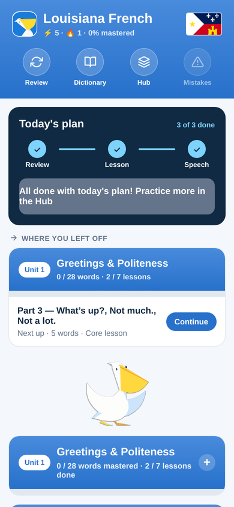
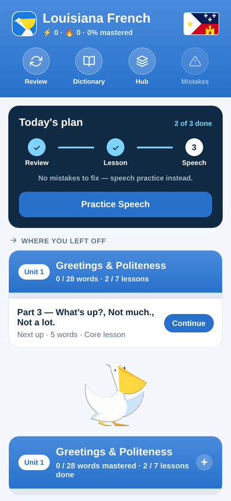

# Evidence for the Speech Practice retry

Captured on Expo web at `http://localhost:19011` (phone-sized window). Android emulator `emulator-5554` was already in use, so this run did not touch it. iOS was not run.

The learner was a local profile with today's review done and one lesson finished before today, so Home offered Daily Speech Practice. Each phrase was recorded with a browser microphone, played back, and accepted.

Two failures were forced in that local run only. They are not in this branch.

## Completion save fails after XP is saved

On attempt 5 of 5, the XP save succeeded and the session save was forced to fail. The screen said the attempt could not be saved. The learner tapped **Sounds good, next phrase** again.

- Before: Home then showed **6** XP. The saved streak time was rewritten.
- After: Home showed **5** XP. The streak time stayed the same. The plan was still marked done.

## Next step throws after a good save

On attempt 5 of 5, both saves succeeded and the step that leaves Speech Practice was forced to throw.

- Before: the screen said the attempt could not be saved.
- After: the screen says the attempt was saved and the next step could not start.

## After merging the loading timeout

The same Expo web session, after main's loading message and 8 second timeout were merged in. Failures were forced only for the captures.

Daily Speech Practice stayed on "Loading Daily Speech Practice." while the progress read never finished. After 8 seconds it showed the error, with Try again and Home. Home returned to today's plan and did not award XP.

On the last of five phrases, the session save failed once and the learner tapped Sounds good again. Home showed 5 XP and the streak time did not change. When the next step threw after a good save, the screen said the attempt was saved.

