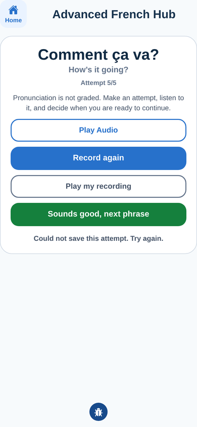

# Evidence for the Speech Practice retry

Captured on Expo web at `http://localhost:19011` (phone-sized window). Android emulator `emulator-5554` was already in use, so this run did not touch it. iOS was not run.

The learner was a local profile with today's review done and one lesson finished before today, so Home offered Daily Speech Practice. Each phrase was recorded with a browser microphone, played back, and accepted.

Two failures were forced in that local run only. They are not in this branch.

## Completion save fails after XP is saved

On attempt 5 of 5, the XP save succeeded and the session save was forced to fail. The screen said the attempt could not be saved. The learner tapped **Sounds good, next phrase** again.

- Before: Home then showed **6** XP. The saved streak time was rewritten.
- After: Home showed **5** XP. The streak time stayed the same. The plan was still marked done.

## Next step throws after a good save

On attempt 5 of 5, both saves succeeded and the step that leaves Speech Practice was forced to throw.

- Before: the screen said the attempt could not be saved.
- After: the screen says the attempt was saved and the next step could not start.

