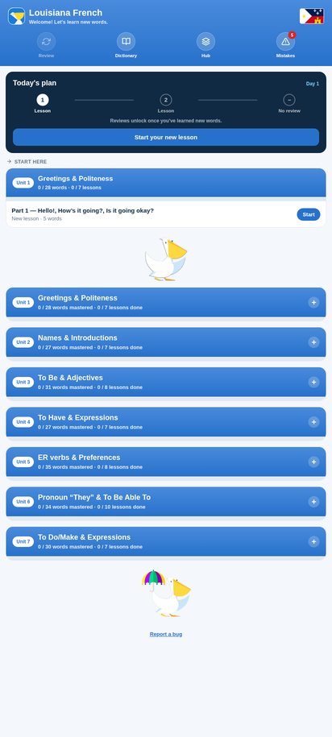

# Evidence for issue 468

Captured on Expo web at `http://localhost:19014` in a phone-sized window. Android emulator `emulator-5554` was already in use, so this run did not touch it. iOS was not run.

Pending mistakes on the device were `""`, a valid Hello card, `"   "`, `null`, and a valid "How's it going?" card. Home counts all five. Mistake Review should show only the two cards.

## Before (origin/main)

Home loaded and the Mistakes control showed a badge of 5. Tapping Mistakes opened a blank screen. The page error was `TypeError: Cannot read properties of null (reading 'cardId')`.

## After

The same seed. Home still shows the badge of 5. Tapping Mistakes opens Mistake Review at 1 / 2 on "Choose the match for 'Hello!'". The blank records are not shown.

