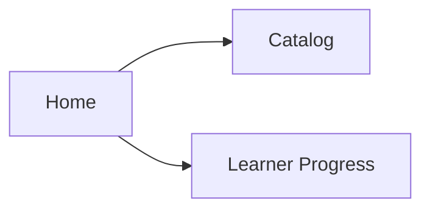
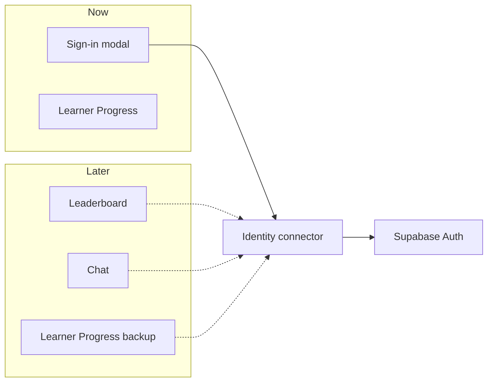

# How Identity connects

Update this file in the same change when Identity behavior or this design changes. Words used here are defined in `CONTEXT.md`. The storage decision is [ADR 0005](adr/0005-supabase-auth-for-identity.md). The current spec is GitHub issue 275. A diagrammed copy of this explainer is `docs/identity-connector.html`.

Home signs a learner in through one connector. Later features use that same connector for the learner’s id and a token. They never talk to Supabase themselves.

## The learner, today

A learner can study as a Guest. Home reads the Catalog and Learner Progress. Learner Progress is lesson history, Word mastery, Card review, XP, and streaks. It stays on the device. Home also has an identity row. It reads Sign in until the learner creates an identity, signs in with email, or continues with Google. Facebook is not on that row yet.

Sign-in is added beside this path. It does not replace Learner Progress.

## One connector

An Identity is a signed-in learner. It has a stable id, an email, and a Display name. The Display name is not unique, and it is not the username stored with Learner Progress. A Guest is a learner with no Identity on the device they are using. The same Identity can be present on a phone and absent on the web.

Screens ask a connector. The connector is the only door. Supabase Auth sits behind it and is the first implementation. Email and password, Google, and Facebook all come back as the same Identity.

Solid arrows are this sign-in work. Dashed arrows are later callers. They stop at the connector. Learner Progress stays beside Home and is not sent through the connector in this work.

### What a caller may ask

- **Who is here?** `getIdentity()` returns `{ id, email, displayName }`, or nothing for a Guest.
- **May I call another service?** `getAccessToken()` returns the current access token in memory, or nothing. The caller sends it as a bearer token on its own request. The refresh token stays inside the connector.
- **Did that change?** A subscription fires when an Identity appears or clears.

Sign-up, email sign-in, Google, Facebook, password reset, and sign-out are the write side of that same connector. Sign-out clears this device only. Another device keeps its Identity. Lessons, XP, and the local username stay where they are.

## Where the session lives

The password is sent once and hashed by Supabase. The app does not store it. On iOS and Android each save creates a new key in the platform keystore, marked so a backup does not carry it to another device. The session itself is ciphertext in app storage. On the web there is no keystore, so the session sits in the origin’s `localStorage`. Any script on that origin can read it. That limit is accepted, and it is not how the phone stores the session.

A later feature never reads these stores. It asks the connector for a token.

## Later callers

These are known and not built. None of them is specified beyond the connector calls below.

### Leaderboard

The board does not learn Supabase, and it does not key rows by Display name. Display names can repeat. The row key is `id`.

When the leaderboard is built, it asks `getIdentity()`. A Guest sees the local board, as today. An Identity sends `id`, the Display name, and `getAccessToken()` to the leaderboard’s own service. That service checks the token. The connector has already refreshed it. The board never sees the refresh token, the password, or the keystore.

XP in Learner Progress can stay on the device until that service exists. Sign-in does not upload it.

### Chat

Chat uses the same two calls, plus the subscription. When an Identity appears, chat connects with `id` and the access token. When the learner signs out, the subscription fires and chat drops. A Guest is not in chat. Chat does not import Supabase, and it does not keep its own copy of the session.

### Backup and retrieval of Learner Progress

A later backup will save Learner Progress for an Identity and bring that progress back onto a device. A Guest keeps progress only on the device they are using. The backup will ask the connector for `id` and `getAccessToken()`, then talk to its own service. This sign-in work does not upload Learner Progress. How backup and retrieval work is not decided yet.

## What this work does not build

The connector does not upload Learner Progress, replace the local leaderboard, open a chat, or back up progress. Those stay future callers. Because they are limited to the id, the Display name, the access token, and the subscription, adding them does not mean opening Supabase, the keystore, or the password path again.
