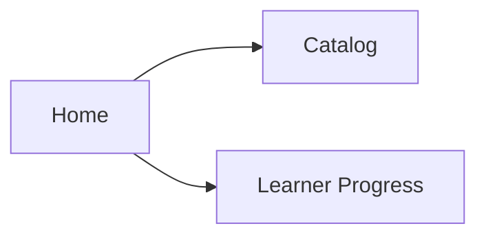
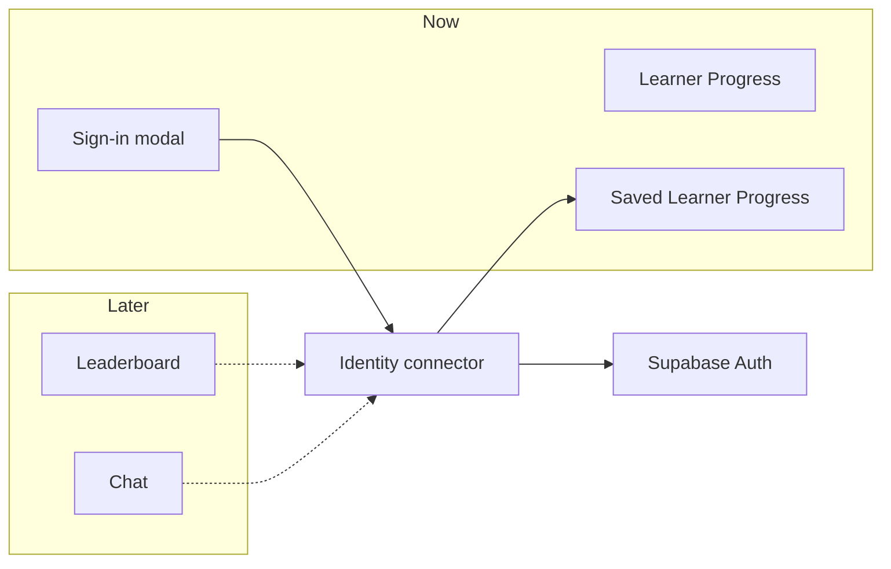

# How Identity connects

Update this file in the same change when Identity behavior or this design changes. Words used here are defined in `CONTEXT.md`. The storage decision is [ADR 0005](adr/0005-supabase-auth-for-identity.md). The current spec is GitHub issue 275. A diagrammed copy of this explainer is `docs/identity-connector.html`.

Home signs a learner in through one connector. Later features use that same connector for the learner’s id and a token. They never talk to Supabase themselves. Home composes Learner Progress presentation from `src/home/`; Identity, About, and navigation stay on `HomeScreen`.

## The learner, today

A learner can study as a Guest. Home reads the Catalog and Learner Progress. Learner Progress is lesson history, Word mastery, Card review, XP, and streaks. It stays on the device. The square icon on Home opens a menu. Account is first (`SHOW_ACCOUNT_MENU_ENTRY` in `HomeAboutMenu`), then About Us, then Support. On release/`main` that flag stays false until Identity is ready (#344); this Identity continuation branch turns it on for testing. Choosing Account opens a note from T-Boy. Sign in is the first screen. Google is a logo button. OAuth `redirectTo` uses `Linking.createURL('auth/callback')`, rewritten to `exp://<Metro-host>/--/auth/callback` when Expo Go would otherwise emit the app scheme. Expo Go cannot open `com.westleysturhan.louisianafrench://`. Supabase Auth also rejects redirect hosts that are raw IPv4 addresses ([auth#2039](https://github.com/supabase/auth/issues/2039)), so Expo Go on a LAN IP silently falls back to Site URL and the browser hangs — use `expo start --tunnel` or a native dev/release build for Google. Supabase Redirect URLs need `exp://**` and the standalone scheme. On Android the connector also listens for the deep link when the auth-session API alone would hang. Create an account is text only and asks for a Display name, an email, and a password. Creating with email asks the learner to check that email and leaves them a guest until they confirm. Sign-up confirmation and password-reset links both set `emailRedirectTo` / `redirectTo` to `com.westleysturhan.louisianafrench://auth/callback` so Supabase does not fall back to Auth Site URL (for example `http://localhost:3000`). That app scheme must also be listed under Supabase Auth redirect URLs; Expo Go cannot open it—use a native build for the return, or sign in with email after confirming. Forgot password? is text only on Sign in. It emails a one-time link back to this app. Opening that link asks for a new password before Home can close the note. A recovery return is not treated as Google. A guest sees Account. A signed-in learner sees Account with the Display name. The learner-facing word there is Account. The domain term remains Identity. Email and Google both return that same Identity. Support is a top-level menu row (not under About Us). It opens the same bug-report sheet as Report a bug on Home, after the menu closes, so the mail draft keeps the `[Louisiana Languages Bug]` subject stamp and the Device block. That sheet sits just above the keyboard, keeps Name, Email, and What happened? in view (scroll if needed), and keeps Cancel and Submit in a sticky row.

Sign-in is added beside this path. It does not replace Learner Progress.

## One connector

An Identity is a signed-in learner. It has a stable id, an email, and a Display name. The Display name is not unique, and it is not the username stored with Learner Progress. A Guest is a learner with no Identity on the device they are using. The same Identity can be present on a phone and absent on the web.

Screens ask a connector. The connector is the only door. Supabase Auth sits behind it and is the first implementation. Email and password and Google come back as the same Identity.

Solid arrows are this sign-in work. Dashed arrows are later callers. They stop at the connector. Home still keeps Learner Progress on the device. When an Identity appears or clears, the connector tells Saved Learner Progress to Claim, Restore, or stop updates. Screens do not talk to Supabase.

### What a caller may ask

- **Who is here?** `getIdentity()` returns `{ id, email, displayName }`, or nothing for a Guest.
- **May I call another service?** `getAccessToken()` returns the current access token in memory, or nothing. The caller sends it as a bearer token on its own request. The refresh token stays inside the connector.
- **Did that change?** A subscription fires when an Identity appears or clears.

Sign-up, email sign-in, Google, password reset, sign-out, and deleting the account are the write side of that same connector. A signed-in Account screen shows Log out and Delete account. Sign-out clears this device only. Another device keeps its Identity. Delete account removes that Identity and its Saved Learner Progress, then clears this device the same way. Lessons, XP, and the local username stay where they are.

## Where the session lives

The password is sent once and hashed by Supabase. The app does not store it. On iOS and Android each save creates a new key in the platform keystore, marked so a backup does not carry it to another device. The session itself is ciphertext in app storage. On the web there is no keystore, so the session sits in the origin’s `localStorage`. Any script on that origin can read it. That limit is accepted, and it is not how the phone stores the session.

A later feature never reads these stores. It asks the connector for a token.

A release build carries the public project URL and publishable key for its EAS profile. The connector reads `process.env.EXPO_PUBLIC_SUPABASE_URL` and `process.env.EXPO_PUBLIC_SUPABASE_ANON_KEY` directly, so that build can contain them. A caller that passes its own values uses those instead. The secret key is not part of the build.

## Later callers

These are known and not built. None of them is specified beyond the connector calls below.

### Leaderboard

The board does not learn Supabase, and it does not key rows by Display name. Display names can repeat. The row key is `id`.

When the leaderboard is built, it asks `getIdentity()`. A Guest sees the local board, as today. An Identity sends `id`, the Display name, and `getAccessToken()` to the leaderboard’s own service. That service checks the token. The connector has already refreshed it. The board never sees the refresh token, the password, or the keystore.

XP on the leaderboard can stay on the device until that service exists. Sign-in does not send XP to the leaderboard. Saved Learner Progress is a different record and is described below.

### Chat

Chat uses the same two calls, plus the subscription. When an Identity appears, chat connects with `id` and the access token. When the learner signs out, the subscription fires and chat drops. A Guest is not in chat. Chat does not import Supabase, and it does not keep its own copy of the session.

### Saved Learner Progress

Saved Learner Progress is one record per Identity per Language. The words are in `CONTEXT.md`. The decision is [ADR 0006](adr/0006-saved-learner-progress.md) and the spec is GitHub issue 348. A Guest keeps Learner Progress only on the device they are using. When an Identity appears, the connector calls `keepSavedLearnerProgressFor` with that id and `getAccessToken()`. That module Claims, Restores, resumes, or records a Progress clash for each Language. It talks to its own service. Screens do not. Sign-out keeps on-device Learner Progress with the Identity who just left, including progress made after an empty sign-in, and stops updates so the next Identity cannot Claim it. A failed read does not Claim. A later study step writes its new rows through that same module. The phone stores the step first.

## What this work does not build

The connector does not replace the local leaderboard or open a chat. Those stay future callers. Saved Learner Progress is called from the connector and keeps its own service. Screens still do not open Supabase, the keystore, or the password path.
